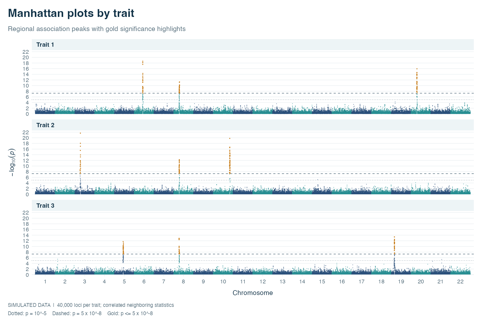

# Manhattan plots with ggplot2

Plot GWAS results for one or more chromosomes, with optional panels for each trait.
The repository also includes a reproducible example-data generator.



## Setup

Run the examples and tests from the repository root. Install ggplot2 once:

```r
install.packages("ggplot2")
```

The simulator itself uses base R. Plotting and the regression checks need ggplot2.
The current checks have been run with R 4.5.2 and ggplot2 4.0.2.

## Quick start

```r
library(ggplot2)
source("gg.manhattan.R")
source("simulate_gwas_data.R")

set.seed(42)
gwas_data <- simulate_gwas_data(
  n_snps = 40000, n_traits = 3, n_chromosomes = 22
)
stopifnot(nrow(gwas_data) == 120000)

plot <- gg.manhattan(
  gwas_data,
  facet_by_trait = TRUE,
  plot_title = "Manhattan plot by trait"
)
print(plot)
ggsave("manhattan.png", plot = plot, width = 10, height = 8, dpi = 150)
```

Sourcing the simulator only defines the function: it does not generate data,
reset the random seed, or run the plotting examples. To run the complete example
workflow instead, use:

```sh
Rscript simulate_gwas_data.R
```

The script prints a data summary and two plots; in a noninteractive R session,
the default graphics device normally writes them to `Rplots.pdf`.

## Input data

Pass a data frame to `gg.manhattan()`. Column names can be overridden with
`chr`, `bp`, `p`, `snp`, and `trait`.

| Default column | Contents |
| --- | --- |
| `CHR` | Numeric chromosome identifiers; encode X, Y, or MT as numbers before plotting. |
| `BP` | Numeric base-pair positions within each chromosome. |
| `P` | Finite p-values with `0 < P <= 1` when `logp = TRUE`. |
| `SNP` | Optional SNP identifiers. |
| `trait` | Trait labels required for panels by trait; numeric or character labels are accepted. |

Supply valid, nonmissing chromosome identifiers, positions, and p-values.
With `facet_by_trait = TRUE` and at least two distinct traits, each trait gets
a separate panel. Otherwise the function uses its ordinary plot layout.

For one chromosome, the x-axis shows positions in Mb. For multiple chromosomes,
it uses cumulative positions with chromosome labels.

## Significance thresholds

Threshold arguments are **plotted y-coordinates**, not raw p-values. With the
default `logp = TRUE`, convert a p-value threshold using `-log10(p)`:

```r
threshold_plot <- gg.manhattan(
  gwas_data,
  facet_by_trait = TRUE,
  suggestiveline = -log10(1e-4),   # y = 4
  genomewideline = -log10(1e-6)   # y = 6
)
print(threshold_plot)
```

The defaults are `suggestiveline = 5` and
`genomewideline = -log10(5e-8)` (approximately 7.30103).
Pass `FALSE` to either argument to hide that line.

With `logp = FALSE`, `P` is plotted directly and thresholds still use
y-coordinates. For a score plot, disable the p-value threshold lines and set an
appropriate y-axis label with `+ labs(y = "Score")`.

## Plotting arguments

| Argument | Default | Meaning |
| --- | --- | --- |
| `x` | Required | Input data frame. |
| `chr`, `bp`, `p` | `"CHR"`, `"BP"`, `"P"` | Columns containing chromosomes, positions, and p-values. |
| `snp`, `trait` | `"SNP"`, `"trait"` | Optional SNP and trait columns. |
| `cols` | `c("gray10", "gray60")` | Alternating chromosome colours. |
| `plot_title` | `NULL` | Optional plot title. |
| `chrlabs` | `NULL` | Labels for multi-chromosome plots, in sorted chromosome order; provide one per chromosome. |
| `suggestiveline` | `-log10(1e-5)` | Suggestive threshold at y = 5; `FALSE` hides it. |
| `genomewideline` | `-log10(5e-8)` | Genome-wide threshold at y approximately 7.30103; `FALSE` hides it. |
| `logp` | `TRUE` | Transform `P` to `-log10(P)`; `FALSE` plots the input values directly. |
| `facet_by_trait` | `FALSE` | Stack panels by trait when two or more traits are present. |

The return value is a ggplot object, so it can be printed, extended with
ggplot2 layers, or saved with `ggsave()`.

## Simulated data

`simulate_gwas_data(n_snps = 40000, n_traits = 3, n_chromosomes = 22)`
returns columns `CHR`, `BP`, `P`, `SNP`, and `trait`.

- All three counts must be single positive whole numbers.
- `n_snps` is the exact number of distinct loci **per trait**. The output has
  `n_snps * n_traits` rows, including when the SNP count is not divisible by
  the chromosome count.
- SNPs are distributed as evenly as possible. The first chromosomes receive
  any remainder; chromosomes with no SNPs are omitted. If there are fewer
  SNPs than chromosomes, fewer chromosomes will appear in the output.
- Each locus keeps the same SNP ID, chromosome, and position across traits.
  Positions are sampled without replacement from 1 to 250,000,000 bp within
  each chromosome.
- P-values vary between traits. Each occupied chromosome and trait receives
  between 1 and 5 signal p-values, capped by the available SNP count.
- Call `set.seed()` before generating data to reproduce an example.

```r
set.seed(42)
small_data <- simulate_gwas_data(n_snps = 10, n_traits = 2)
stopifnot(
  nrow(small_data) == 20,
  length(unique(small_data$SNP)) == 10
)

single_trait <- subset(gwas_data, trait == "Trait_1")
print(gg.manhattan(single_trait, plot_title = "Trait 1"))

regional_data <- subset(gwas_data, CHR == 1)
print(gg.manhattan(regional_data, facet_by_trait = TRUE))
```

These data illustrate plotting behaviour. They do not model linkage
disequilibrium, genetic architecture, or correlations between traits.

## Regression checks

```sh
Rscript tests/regression.R
```

The checks cover regional facet axes, chromosome labels, shared SNP coordinates,
independent trait p-values, small and nondivisible SNP counts, invalid arguments,
source-time behaviour, threshold coordinates, and default-size plots.

## Files

| File | Purpose |
| --- | --- |
| `gg.manhattan.R` | Plotting function. |
| `simulate_gwas_data.R` | Simulator and examples run with Rscript. |
| `tests/regression.R` | Standalone regression checks. |
| `Rplot.png` | Example output. |
| `LICENSE.md` | GPL-3.0 licence. |
